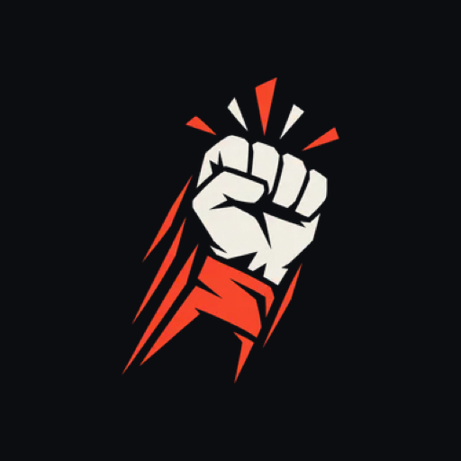

# Brutal Combo for Discord

Get new gaming stories from [Brutal Combo](https://brutalcombo.com/) posted in your Discord server, automatically and for free.

## Set it up

You need to be an owner or admin of the server. There is no account to create and nothing to install.

1. Click **[Add to Discord](https://brutalcombo-discord.lough92.workers.dev/install)**.
2. Pick your server.
3. Pick the channel you want the news in. Any text channel works.
4. Click **Authorize**.

That's it. A "Brutal Combo is connected" message appears in that channel straight away, along with the latest story. After that, every new story shows up there on its own.

## What the posts look like

Each story is a card with the headline, a short summary, the story image, its category (Release, Patch, Rumor and so on) and a link to the full article. Stories usually appear within a few minutes of being published.

## Questions

**Can I use any channel?** Yes. You choose it from a list when you click Add to Discord.

**Can I post to more than one channel?** Yes. Click Add to Discord again and pick another channel.

**How do I move it to a different channel?** In Discord, open **Server Settings → Integrations**. Under "Bots and Apps", click **Manage** next to **Brutal Combo**, click the webhook listed there, and pick a new channel from the **Channel** list.

**How do I remove it?** Open **Server Settings → Integrations**, click **Manage** next to **Brutal Combo**, and click **Remove App**. The posts stop immediately.

**What can it see or do in my server?** It can post in the one channel you picked. That is all. It can't read messages, see members, or touch any other channel. No bot joins your server.

**I don't see my server in the list.** Discord only lists servers where you are allowed to manage webhooks. Ask an admin to add it, or to give you the **Manage Webhooks** permission.

**Does it cost anything?** No.

---

## For the curious: how it works

The code in this repository runs as a small [Cloudflare Worker](https://developers.cloudflare.com/workers/). It does two jobs:

- **Connecting a channel.** The Add to Discord link sends you to Discord, where you pick a server and channel. Discord creates a webhook for that channel and hands it to the Worker, which stores it and posts the welcome message.
- **Posting stories.** Every two minutes the Worker reads the site's [RSS feed](https://brutalcombo.com/feed.xml). When there is a story it hasn't posted, it sends it to every connected channel. If a webhook has been deleted, the Worker forgets that channel.

The files:

- `src/index.js`: the web addresses and the timer.
- `src/core.js`: everything else: reading the feed, building the cards, connecting channels and delivering stories.
- `wrangler.jsonc`: the Cloudflare settings.
- `logo.png`: the picture shown on every post.

Connected channels and the list of posted stories are kept in Cloudflare's key-value storage, not in this repository.

### Run your own copy

You only need this if you want your own version, for example for a different news feed.

1. Fork this repository.
2. Create an application in the [Discord Developer Portal](https://discord.com/developers/applications). Copy its **Application ID** and, on the **OAuth2** page, its **Client Secret**.
3. In your fork's `wrangler.jsonc`, set `DISCORD_CLIENT_ID` to your Application ID, set `FEED_URL` to your feed, and delete the `"id"` from the `kv_namespaces` entry so Cloudflare creates storage for you.
4. In the [Cloudflare dashboard](https://dash.cloudflare.com/), go to **Workers & Pages → Create → Connect GitHub**, pick your fork, and deploy.
5. In the Worker's **Settings → Variables and secrets**, add a secret named `DISCORD_CLIENT_SECRET` with your Client Secret.
6. Back in the Discord Developer Portal, on the **OAuth2** page, add a redirect: your Worker's address followed by `/callback`.

Your Add to Discord link is your Worker's address followed by `/install`.

## License

The source code is released under the [MIT License](LICENSE). The Brutal Combo name, logo (`logo.png`), and feed content belong to Brutal Combo and are not covered by this license.
